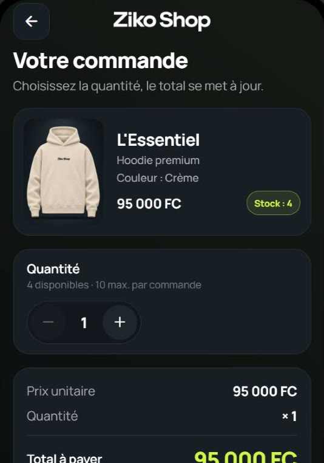
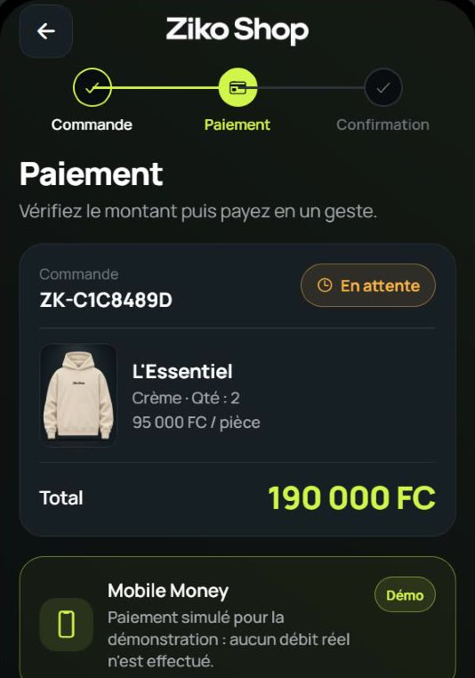
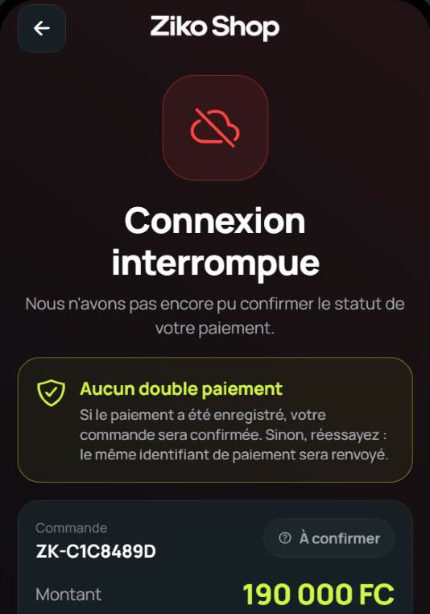
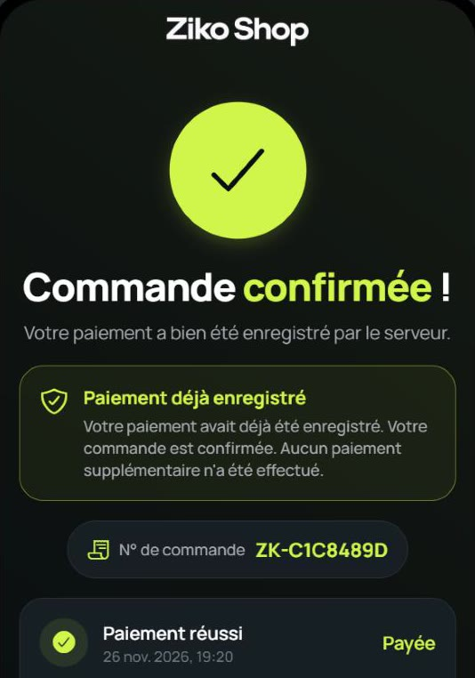
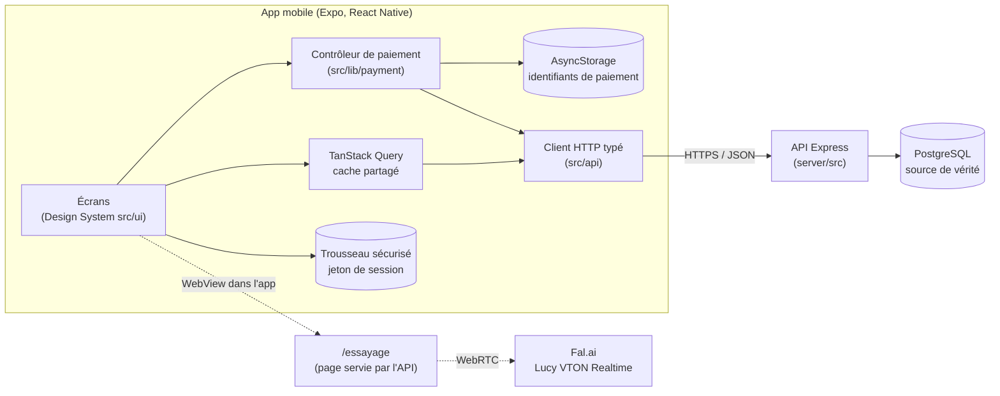

# Ziko Shop — Modern Wear. Smart Shopping.

[](https://github.com/Risthan/ziko-shop/actions/workflows/ci.yml)

Test technique « Développeur fullstack » pour Ziko : une **API** (Node.js, Express, TypeScript, PostgreSQL) qui gère des produits, des commandes et leur paiement, et une **app mobile** (React Native, Expo, TypeScript) branchée dessus.

Ziko Shop vend trois modèles de pulls (Le Classique, L'Essentiel, Le Signature), chacun en trois couleurs : Noir, Crème et Moka. Cela fait 9 produits, avec des prix en francs congolais. L'objectif est double : une app qui donne l'impression d'être déjà commercialisée, et, derrière, **un paiement qui ne débite jamais deux fois**, même quand le réseau coupe ou que les requêtes arrivent en même temps.

| | Lien |
|---|---|
| API en ligne | https://ziko-shop-api.onrender.com (`/health`, `/products`) |
| App (EAS Update, Expo Go) | https://expo.dev/accounts/risthan-apps/projects/ziko-shop. Onglet « Updates », branche `production`, bouton « Aperçu » : QR code à scanner avec Expo Go. |
| Dépôt | https://github.com/Risthan/ziko-shop |

<p>
  
  
  
  
  
  
</p>

---

## Sommaire

1. [Lancer le projet](#1-lancer-le-projet)
2. [Architecture](#2-architecture)
3. [L'API](#3-lapi)
4. [Le point le plus important : jamais deux paiements](#4-le-point-le-plus-important--jamais-deux-paiements)
5. [L'app mobile](#5-lapp-mobile)
6. [Choix techniques et pourquoi](#6-choix-techniques-et-pourquoi)
7. [Sécurité : failles repérées et ce que j'ai fait](#7-sécurité--failles-repérées-et-ce-que-jai-fait)
8. [Ce que j'améliorerais avec plus de temps](#8-ce-que-jaméliorerais-avec-plus-de-temps)
9. [Scénario de la vidéo de démonstration](#9-scénario-de-la-vidéo-de-démonstration)
10. [Ce que l'IA a écrit, ce que j'ai fait](#10-ce-que-lia-a-écrit-ce-que-jai-fait)
11. [Organisation du dépôt](#11-organisation-du-dépôt)

---

## 1. Lancer le projet

Prérequis : **Node.js 22 ou plus** (24 recommandé) et npm. Docker est facultatif.

### Le serveur, en une commande (Docker)

```bash
docker compose up --build
```

L'API répond sur http://localhost:3000, avec PostgreSQL et les 9 pulls déjà en boutique.

### Le serveur, sans Docker

```bash
cd server
npm install
cp .env.example .env      # sous Windows : copy .env.example .env
npm run db:local          # terminal 1 : lance un vrai PostgreSQL local (aucune installation)
npm run dev               # terminal 2 : lance l'API sur http://localhost:3000
```

`npm run db:local` démarre PostgreSQL grâce au paquet `embedded-postgres`. Vous pouvez aussi utiliser votre propre base en changeant `DATABASE_URL` dans `.env`. Au démarrage, les migrations s'appliquent, puis la boutique est remplie si elle est vide (`SEED_ON_START=true`).

### Les tests

```bash
cd server && npm test      # 93 tests sur un vrai PostgreSQL jetable (concurrence, panier, comptes et administration compris)
cd mobile && npm test      # 22 tests : paiement côté app (coupures, réouverture, double clic), panier, formatage
```

Les deux suites, le typage et la construction de l'image Docker tournent aussi dans la CI GitHub à chaque push.

### L'app mobile

```bash
cd mobile
npm install
cp .env.example .env      # puis mettez l'adresse de l'API (voir ci-dessous)
npx expo start            # scannez le QR code avec Expo Go
```

- Sans fichier `.env`, l'app utilise l'API en ligne.
- Pour l'API locale sur un téléphone, mettez l'IP de l'ordinateur, par exemple `EXPO_PUBLIC_API_URL=http://192.168.1.20:3000`. Le téléphone et l'ordinateur doivent être sur le même Wi-Fi.

### Publier l'app (EAS Update)

```bash
cd mobile
npx eas-cli@latest login
npx eas-cli@latest update --branch production --environment production --message "…"
```

L'app n'utilise que des modules inclus dans Expo Go. Elle est publiée avec `runtimeVersion: { policy: "sdkVersion" }`, soit le runtime `exposdk:58.0.0`, que Expo Go ouvre directement. Avec `--environment production`, le fichier `.env` local est ignoré : l'app publiée appelle l'API en ligne.

### Variables d'environnement du serveur

| Variable | Rôle |
|---|---|
| `DATABASE_URL` | Connexion PostgreSQL (obligatoire). |
| `DATABASE_SSL` | `true` pour une base distante en TLS (le certificat est vérifié). |
| `ADMIN_API_KEY` | Clé d'administration : créer ou modifier un produit, page `/admin`. Au moins 16 caractères, obligatoire en production. |
| `SEED_ON_START` | `true` : ajoute les 9 pulls si la boutique est vide. |
| `CORS_ORIGINS` | Origines autorisées (`*` par défaut). |
| `FAL_KEY` | Facultative : clé Fal.ai qui active l'essayage en direct (voir § 5). |

### Administrer la boutique (page `/admin`)

Ouvrez **https://ziko-shop-api.onrender.com/admin/** et entrez la clé `ADMIN_API_KEY`. Sur Render, elle se trouve dans **ziko-shop-api → Environment**. La page permet de :

- voir les chiffres : commandes, commandes payées, chiffre d'affaires, comptes clients ;
- modifier le nom, la photo, le prix ou le stock de chaque pull. Les commandes déjà passées gardent leur prix ;
- supprimer un pull : il est effacé s'il n'a jamais été commandé. Sinon, il est seulement **retiré de la vente**, pour que les commandes passées restent intactes, et on peut le remettre en vente ;
- ajouter un pull, nommé « Modèle — Couleur » pour que l'app regroupe les couleurs ;
- remettre le stock des 9 pulls à l'état de départ, par exemple après une démonstration ;
- voir les dernières commandes.

La clé reste dans l'onglet du navigateur : fermer l'onglet déconnecte. Les mêmes actions existent dans l'API (`PATCH /products/:id`, `DELETE /products/:id`, `POST /products/:id/restore`, `POST /admin/reset-stock`, `GET /admin/products`, `GET /admin/summary`), avec l'en-tête `X-Admin-Key`.

### Déploiement

Le fichier `render.yaml` crée sur Render l'API (via Docker) et sa base PostgreSQL, gratuitement, dans la région Francfort. C'est la plus proche de Kinshasa parmi celles de Render. Il suffit de choisir **New → Blueprint → ce dépôt**.

L'hébergement gratuit met l'API en veille après 15 minutes sans visite. Deux parades :

- l'app attend jusqu'à 75 secondes en expliquant que le serveur se réveille ;
- un workflow GitHub (`keep-alive.yml`) garde l'API éveillée.

---

## 2. Architecture



- **Le serveur et PostgreSQL font foi.** L'app ne stocke ni prix ni stock. Elle garde seulement les identifiants de ses commandes et de ses paiements (pour pouvoir reprendre un paiement incertain), et le contenu du panier (identifiants et quantités).
- **Côté app**, chaque écran lit ses données via TanStack Query. Après un paiement confirmé, la commande est mise à jour et le catalogue est rechargé, ce qui actualise le stock.
- **L'essayage en direct** est un module isolé. Sans configuration, l'app reste complète.

---

## 3. L'API

Toutes les réponses sont en JSON. Les erreurs ont toujours la même forme, avec un **code stable** (utilisé par l'app) et un **message clair en français** :

```json
{ "error": { "code": "INSUFFICIENT_STOCK", "message": "Stock insuffisant : il reste 2 pièce(s), vous en demandez 5.", "details": { "available": 2, "requested": 5 } } }
```

| # | Méthode et route | Rôle | Réponses |
|---|---|---|---|
| 1 | `POST /products` | Créer un produit `{ name, priceCdf, stock, imageUrl? }`. Exige l'en-tête `X-Admin-Key`. | 201, 400, 401 |
| | `PATCH /products/:id` | Modifier le prix, le stock, le nom ou la photo d'un produit (clé d'administration). | 200, 400, 401, 404 |
| | `DELETE /products/:id`, `POST /products/:id/restore` | Supprimer un produit (effacé s'il n'a jamais été commandé, sinon retiré de la vente) ; le remettre en vente (clé d'administration). | 200, 401, 404 |
| | `GET /admin/summary`, `POST /admin/reset-stock` | Chiffres de la boutique ; remise du stock à l'état de départ (clé d'administration). | 200, 401 |
| 2 | `GET /products?search=` | Lister les produits (recherche facultative par nom). | 200 |
| | `GET /products/:id` | Un produit. | 200, 404 |
| 3 | `POST /orders` | Commander un produit `{ productId, quantity }` (format du sujet) ou un panier `{ items: [{ productId, quantity }, …] }`. Refusée si le stock d'un article est insuffisant (l'erreur dit lequel), sinon `en_attente`. En-tête `Idempotency-Key` facultatif. | 201, 200 (déjà créée), 400, 404, 409 |
| 4 | `POST /orders/:id/pay` | Payer `{ paymentId }`. La commande passe à `payee` et le stock de chaque article diminue. | 200, 400, 404, 409 |
| 5 | `GET /orders/:id` | Consulter une commande et son statut. Une commande rattachée à un compte n'est visible que par son propriétaire. | 200, 404 |
| | `POST /auth/register`, `POST /auth/login`, `POST /auth/logout` | Créer un compte, se connecter (renvoie un jeton de session), se déconnecter. | 201, 200, 204, 400, 401, 409 |
| | `GET /me`, `PATCH /me`, `DELETE /me` | Mon profil, le modifier, supprimer mon compte (mot de passe demandé). En-tête `Authorization: Bearer <jeton>`. | 200, 204, 400, 401 |
| | `GET /me/orders` | Mon historique d'achats, le plus récent d'abord. | 200, 401 |
| | `GET /health`, `/features`, `/try-on/config` | État du serveur, fonctionnalités facultatives actives. | 200 |

Règles de données :

- **Prix** en francs congolais : un entier, de 1 à 10 000 000 FC.
- **Stock** : un entier, de 0 à 1 000 000.
- **Quantité** : de 1 à 100 par article.
- **Panier** : de 1 à 20 articles différents, chaque produit une seule fois (les quantités sont regroupées). Une commande renvoie ses lignes dans `items`, avec le prix figé de chacune, `itemCount` (nombre de pièces) et `totalCdf`.
- **Identifiant de paiement** : 8 à 64 caractères (lettres, chiffres, `-` ou `_`).
- **Le serveur calcule lui-même le prix et le total.** Le client n'envoie jamais de montant.

```bash
API=https://ziko-shop-api.onrender.com
curl $API/products
curl -X POST $API/orders -H "Content-Type: application/json" -d '{"productId":"<id>","quantity":2}'
curl -X POST $API/orders -H "Content-Type: application/json" -d '{"items":[{"productId":"<id1>","quantity":2},{"productId":"<id2>","quantity":1}]}'   # panier
curl -X POST $API/orders/<orderId>/pay -H "Content-Type: application/json" -d '{"paymentId":"MM-2026-000001"}'
curl -X POST $API/orders/<orderId>/pay -H "Content-Type: application/json" -d '{"paymentId":"MM-2026-000001"}'   # renvoyé : rien n'est refait
curl $API/orders/<orderId>
```

---

## 4. Le point le plus important : jamais deux paiements

> Si le même paiement est envoyé deux fois, ou si la commande est déjà payée, rien ne doit être débité ni décompté une seconde fois.

La garantie repose sur **le serveur et la base de données**. L'app, elle, fait en sorte de toujours renvoyer le **même** identifiant, et d'afficher au client ce qui s'est réellement passé.

### Côté serveur (`server/src/orders/orders.service.ts`, fonction `payOrder`)

Tout se passe dans **une seule transaction PostgreSQL** :

1. **`SELECT … FROM orders WHERE id = $1 FOR UPDATE`** verrouille la ligne de la commande. Si deux requêtes de paiement arrivent en même temps pour la même commande, la seconde **attend** que la première ait fini.
2. Une fois le verrou obtenu, on **relit le statut** :
   - **déjà payée avec le même identifiant** : c'est une répétition. On répond `200` avec `payment.outcome = "already_processed"`, **sans rien refaire** ;
   - **déjà payée avec un autre identifiant** : refus `409 ORDER_ALREADY_PAID`, aucun débit.
3. Un identifiant de paiement déjà utilisé pour **une autre commande** est refusé (`409 PAYMENT_ID_ALREADY_USED`).
4. Les produits de la commande sont verrouillés à leur tour, **toujours dans le même ordre** (par identifiant) : deux paniers qui partagent des produits ne peuvent pas se bloquer mutuellement. Le stock de chaque article est relu **sous verrou**. S'il manque une seule pièce, on renvoie `409 INSUFFICIENT_STOCK` (avec le nom de l'article) et rien n'est débité.
5. Sinon, **dans la même transaction**, trois opérations : le stock de chaque article diminue, le paiement est enregistré, la commande passe à `payee`. C'est **tout ou rien**.

**Filet de sécurité dans la base** : la clé primaire `payments.id` est l'identifiant de paiement, `UNIQUE (order_id)` interdit deux paiements pour une commande, et `CHECK (stock >= 0)` interdit un stock négatif.

### Côté app (`mobile/src/lib/payment/paymentController.ts`)

1. Au premier appui sur « Payer », l'app crée **un identifiant de paiement unique** pour la commande.
2. Elle l'**enregistre sur le téléphone (AsyncStorage) avant d'envoyer la requête**. Si l'app se ferme en plein paiement, l'identifiant n'est pas perdu.
3. Chaque nouvelle tentative renvoie **exactement le même identifiant**, même après une fermeture et une réouverture de l'app. Il n'est jamais régénéré pour une simple relance.
4. **Une seule requête à la fois** par commande : un double appui partage la requête en cours. Le bouton est aussi désactivé pendant le traitement, mais ce n'est qu'un confort ; la garantie reste celle du serveur.
5. **Une réponse absente n'est jamais traitée comme un échec.** L'écran « Connexion interrompue » dit : « Nous n'avons pas encore pu confirmer le statut de votre paiement. » Il propose « Réessayer » (même identifiant) ou « Vérifier le statut » (`GET /orders/:id`, le serveur fait foi).
6. Si le serveur répond « déjà enregistré », l'app affiche : « Votre paiement avait déjà été enregistré. Votre commande est confirmée. Aucun paiement supplémentaire n'a été effectué. »
7. **La confirmation n'apparaît que si le serveur dit que la commande est payée.** Au lancement suivant, l'accueil rappelle un paiement resté à confirmer.

```mermaid
sequenceDiagram
  participant App
  participant Tel as Téléphone (AsyncStorage)
  participant API
  participant DB as PostgreSQL
  App->>Tel: enregistre paymentId = MM-abc pour la commande 42
  App->>API: POST /orders/42/pay { paymentId: MM-abc }
  API->>DB: BEGIN ; SELECT … FOR UPDATE ; stock - 2 ; INSERT payment ; payee ; COMMIT
  API--xApp: réponse perdue (réseau coupé)
  Note over App: « Connexion interrompue »<br/>statut « À confirmer »
  App->>Tel: relit paymentId = MM-abc (même après réouverture)
  App->>API: POST /orders/42/pay { paymentId: MM-abc }
  API->>DB: SELECT … FOR UPDATE : déjà payée par MM-abc
  API-->>App: 200 already_processed (rien n'est refait)
  Note over App: « Commande confirmée — paiement déjà enregistré,<br/>aucun débit supplémentaire »
```

### Ce qui le prouve

| Scénario | Où | Résultat vérifié |
|---|---|---|
| Même paiement renvoyé | `server/test/payment.test.ts` | 200 `already_processed`, stock inchangé |
| 10 envois simultanés du même paiement | idem | 1 seul `processed`, 1 seul paiement en base |
| 5 identifiants différents en même temps | idem | un seul passe, les autres 409 |
| Deux clients pour la dernière pièce | idem | un seul paie, le stock reste à 0 |
| Identifiant déjà utilisé ailleurs | idem | 409, la seconde commande reste en attente |
| Panier : un article épuisé entre-temps | idem | 409 avec le nom de l'article, aucun stock ne bouge |
| Panier : 10 envois simultanés | idem | 1 seul débit, chaque stock baisse une fois |
| Deux paniers croisés payés en même temps | idem | pas d'interblocage, stocks justes |
| Identifiant enregistré avant l'envoi | `mobile/src/lib/payment/paymentController.test.ts` | vrai au moment de l'appel réseau |
| Coupure **avant** que le serveur reçoive | idem | la relance paie, même identifiant, 1 débit |
| Coupure **après** l'enregistrement | idem | la relance confirme, même identifiant, 1 débit |
| Réouverture de l'app après une coupure | idem | identifiant relu, aucun nouveau créé |
| Double clic sur « Payer » | idem | une seule requête envoyée |

---

## 5. L'app mobile

Expo SDK 58, Expo Router, TypeScript strict, TanStack Query, Reanimated et Manrope. L'app fonctionne sur iPhone et Android dans Expo Go.

### Écrans

| Écran | Fichier | Contenu |
|---|---|---|
| Accueil et catalogue | `src/app/(tabs)/index.tsx` | Bannière « Votre style. Vos règles. », recherche par nom (sans accents), collections, grille de 2 produits par ligne (nom, prix « 75 000 FC », stock, couleurs), squelettes de chargement, états vide, sans résultat et serveur injoignable. Rappel d'un paiement à confirmer. |
| Fiche produit | `src/app/product/[id].tsx` | Photo, vignettes et pastilles des couleurs (changement en place : image, prix et stock), bouton principal « Commander » (désactivé si épuisé), « Au panier » et « Essayer ». |
| Essayage en direct | `src/app/(tabs)/essayage.tsx` | La caméra s'ouvre **dans l'app** et l'essayage démarre tout seul. Changer de modèle ou de couleur relance l'essayage avec le nouveau pull. « Ajouter au panier » et « Commander ce pull » restent toujours possibles, même si le service d'essayage est indisponible. |
| Panier | `src/app/(tabs)/panier.tsx` | Plusieurs pulls, chacun avec sa quantité, un raccourci « Essayer », le total, puis une seule commande pour tout le panier. Pastille du nombre de pièces sur l'onglet. Le panier se vide quand sa commande est payée. |
| Commande | `src/app/order/[productId].tsx` | Un produit et une quantité (le parcours du sujet), total recalculé, création de la commande. Une fenêtre s'affiche en cas de stock insuffisant. |
| Paiement | `src/app/payment/[orderId].tsx` | Référence réelle, montant, statut, Mobile Money **marqué comme démonstration**, bouton « Payer », mode démo « couper le réseau ». |
| Connexion interrompue | idem (`Interrupted`) | « Nous n'avons pas encore pu confirmer… », « Réessayer le paiement », « Vérifier le statut de ma commande ». |
| Confirmation | `src/app/confirmation/[orderId].tsx` | Animation de validation, référence, articles et quantités, total payé, statut « Payée ». |
| Suivi de commande | `src/app/orders/[id].tsx` | Statut réel du serveur (« En attente » ou « Payée ») et bouton d'actualisation. Pas de faux suivi de livraison. |
| Profil | `src/app/(tabs)/profil.tsx` | Déconnecté : se connecter ou créer un compte. Connecté : identité, nombre de commandes, total dépensé, **mes achats** (historique du serveur), modifier le profil, se déconnecter, supprimer le compte. |
| Connexion et inscription | `src/app/auth/login.tsx`, `src/app/auth/register.tsx`, `src/app/profile/edit.tsx` | Nom, e-mail, téléphone facultatif, mot de passe (8 caractères minimum). Erreurs claires par champ. Après connexion, retour à la commande en cours. |

### Design System (`src/theme`, `src/ui`)

- **Jetons centralisés** :
  - couleurs : fond `#090D10`, surfaces `#171E24`, accent `#D0F54B` ;
  - typographie Manrope, du Regular à l'ExtraBold ;
  - espacements, rayons, ombres discrètes (pas d'effet néon) et durées d'animation.
- **Composants réutilisés par tous les écrans** : boutons, en-tête avec le logo officiel, barre d'onglets, cartes produits, pastilles de couleurs, sélecteur de quantité, badges de stock et de statut, messages, fenêtre modale, squelettes, états vides et d'erreur, récapitulatif de commande, coche animée et preloader.
- **Animations Reanimated** :
  - apparition en cascade des produits ;
  - pression des boutons (avec retour haptique) ;
  - fondu des images au changement de couleur ;
  - quantité animée ;
  - validation du paiement ;
  - preloader affiché **à la première ouverture uniquement**.

  Toutes respectent le réglage « réduire les animations » du téléphone.
- **Petits écrans** : textes plafonnés à ×1,3 de la taille système, zones tactiles de 44 px minimum, safe areas, bouton retour Android géré.

### Bonus : l'essayage en direct

L'onglet Essayage affiche la page `/essayage?embed=1` de l'API **dans l'app**, grâce à une WebView (`react-native-webview`, inclus dans Expo Go). Rien ne s'ouvre dans une autre fenêtre :

- en arrivant sur l'onglet, l'app demande l'accès à la caméra (fenêtre du système, une seule fois), puis l'essayage **démarre tout seul** ;
- changer de modèle ou de couleur envoie le nouveau pull à la séance en cours : **la vidéo ne se coupe pas** ;
- la page informe l'app de son état (préparation, en direct, terminé, erreur) ; l'app affiche son propre badge et un bouton « Relancer l'essayage » ;
- la caméra s'arrête dès qu'on quitte l'onglet ou que l'app passe en arrière-plan.

**Fournisseur unique : [Fal.ai](https://fal.ai/models/decart/lucy2-vton/realtime/api), modèle Lucy VTON Realtime** (`decart/lucy2-vton/realtime`). La fonctionnalité est **facultative et isolée** (`server/src/tryon`, `server/web/essayage`) :

- **Comment ça marche.** La page ouvre une séance avec le SDK officiel `@fal-ai/client` (`fal.realtime.open` et l'extension `lucyRealtime`). La caméra part en **WebRTC** vers le modèle, qui renvoie la vidéo où le client porte le pull. Le WebSocket de Fal ne sert qu'à établir la connexion et à envoyer le pull choisi (`prompt` et `reference_image_url`, la photo du pull).
- **La clé `FAL_KEY` ne quitte jamais le serveur.** La page demande à `POST /try-on/token` un jeton temporaire : valable 2 minutes pour ouvrir une séance, et limité à ce seul modèle.
- **Coût maîtrisé.** Fal facture 0,02 $ par seconde de vidéo. Une séance dure 30 secondes au plus (environ 0,60 $), et chaque adresse IP peut demander au plus 6 jetons par minute.
- **Sans `FAL_KEY`** : l'app affiche « Essayage indisponible » et propose de commander. Aucune photo n'est présentée comme un flux vidéo.

---

## 6. Choix techniques et pourquoi

- **Express 5 et SQL direct (`pg`), sans ORM.** Le cœur du sujet est une transaction avec verrou. Écrite en SQL lisible, elle s'explique ligne par ligne.
- **Le verrou pessimiste (`SELECT … FOR UPDATE`) plutôt qu'un verrou optimiste.** Les paiements concurrents sur une même commande sont rares mais critiques. La seconde requête attend puis lit l'état final pour répondre précisément. Les contraintes `UNIQUE` servent de seconde ligne de défense.
- **L'identifiant de paiement sert de clé d'idempotence.** C'est l'identifiant naturel d'un paiement Mobile Money.
- **Le stock diminue au paiement**, comme le demande le sujet. Il est donc revérifié sous verrou au moment de payer.
- **La logique de paiement de l'app est indépendante de React** (`paymentController.ts`). On peut ainsi la tester sans téléphone, avec un faux serveur qui applique les mêmes règles.
- **TanStack Query plutôt qu'un store global** : le serveur reste la source de vérité, les écrans partagent un cache, et les écritures ne sont jamais rejouées automatiquement.
- **Tests serveur contre un vrai PostgreSQL** (`embedded-postgres`) : les verrous et la concurrence ne se simulent pas de façon fiable.
- **Le panier s'ajoute au parcours du sujet sans le remplacer.** « Commander » sur la fiche produit mène toujours à l'écran quantité → total → « Payer » demandé. Côté serveur, les lignes vivent dans `order_items` (migration `003`, les anciennes commandes sont reprises) et `POST /orders` accepte toujours `{ productId, quantity }`. Le paiement d'un panier garde exactement les mêmes garanties : une transaction, tout ou rien.
- **Un compte est demandé pour commander dans l'app, mais pas par l'API.** L'app exige d'être connecté avant « Continuer vers le paiement » ou « Commander » : la commande rejoint l'historique du client. L'API, elle, accepte toujours `{ productId, quantity }` sans compte, exactement comme le demande le sujet ; avec un jeton, la commande est rattachée au client et devient privée.
- **Sessions par jeton opaque plutôt que JWT** : le serveur ne garde que l'empreinte SHA-256 du jeton. Se déconnecter ou supprimer son compte coupe l'accès immédiatement, sans liste noire à gérer. Côté téléphone, le jeton est dans le trousseau sécurisé (Keychain ou Keystore), pas en clair.
- **Mots de passe avec scrypt**, inclus dans Node : aucune dépendance de plus, un sel par compte, une comparaison à temps constant.
- **Le panier vit sur le téléphone**, même sans compte : il ne contient que des identifiants et des quantités. Tant que son contenu ne change pas, il renvoie la même clé d'idempotence : appuyer deux fois sur « Commander » ne crée qu'une commande.
- **Render gratuit et Docker** : le même conteneur tourne en local, en CI et en production.

---

## 7. Sécurité : failles repérées et ce que j'ai fait

| Faille possible | Ce que j'ai fait | Ce qui reste |
|---|---|---|
| **Paiement non vérifié auprès d'un opérateur.** N'importe qui connaissant l'identifiant d'une commande pourrait la « payer » avec un identifiant inventé. | Identifiants de commande aléatoires (UUID v4). Montant calculé et figé côté serveur. Identifiant de paiement unique. Limite de 30 paiements par minute et par IP. L'app indique clairement que le Mobile Money est simulé. | En production : vérifier chaque paiement auprès de l'opérateur (API ou webhook signé HMAC), avec contrôle du montant. C'est la limite principale de ce test. |
| **Création de produits par n'importe qui.** | En-tête `X-Admin-Key` comparé à temps constant, obligatoire en production. Sur Render, la clé est générée automatiquement et transmise séparément aux évaluateurs. | Vrais comptes administrateurs avec rôles. |
| **Lecture des commandes d'autrui (IDOR).** | UUID impossibles à deviner. Une commande rattachée à un compte n'est visible et payable que par son propriétaire (les autres reçoivent « introuvable »). L'historique `/me/orders` ne renvoie que les commandes du client connecté. | Jeton propre à chaque commande passée sans compte. |
| **Vol de compte.** | Mots de passe hachés avec scrypt (sel par compte). Même message et même temps de calcul pour « e-mail inconnu » et « mauvais mot de passe ». 20 tentatives par quart d'heure et par IP. Jeton aléatoire de 256 bits, stocké en empreinte côté serveur et dans le trousseau du téléphone. Session expirée après 30 jours d'inactivité. | Vérification de l'e-mail, mot de passe oublié, double authentification. |
| **Injection SQL.** | Requêtes paramétrées partout. Recherche `LIKE` échappée. | — |
| **Montants ou quantités manipulés.** | Validation stricte (entiers, bornes). Prix et total calculés par le serveur. Contraintes `CHECK` en base. | — |
| **Double débit en concurrence.** | Verrou, transaction unique et contraintes `UNIQUE`, testés avec 10 requêtes simultanées. Côté app, identifiant persistant et une seule requête à la fois. | — |
| **Abus ou déni de service.** | Limite globale de 300 requêtes par 15 minutes et par IP. Corps JSON de 10 ko maximum. Requêtes SQL coupées après 10 secondes. | Pare-feu applicatif ou CDN. |
| **Fuite d'informations.** | Erreurs 500 génériques. `X-Powered-By` désactivé. En-têtes `helmet`. Certificat TLS de la base vérifié. | Journalisation centralisée. |
| **Secrets exposés.** | Variables d'environnement, `.env` ignoré par Git. La clé Fal ne part jamais vers le navigateur : il reçoit un jeton de 2 minutes, limité au modèle d'essayage. Le téléphone ne stocke que des identifiants (aucune donnée personnelle). | Rotation des clés. |
| **Caméra et service tiers (Fal.ai).** | La page `/essayage` n'exécute que notre script ; sa politique de sécurité (CSP) n'autorise que le WebSocket de Fal. La caméra est limitée à cette page et à l'onglet Essayage, demande l'autorisation du système, et s'arrête dès qu'on quitte l'onglet. Aucune image n'est enregistrée par Ziko Shop. Séances de 30 secondes et jetons limités par IP, pour éviter qu'on vide les crédits. | Relayer la signalisation par notre serveur pour couper une séance côté serveur. |
| **CORS ouvert (`*`).** | Acceptable : ni cookie ni session, et l'app mobile n'est pas soumise à CORS. Configurable via `CORS_ORIGINS`. | Restreindre si un site web est ajouté. |

---

## 8. Ce que j'améliorerais avec plus de temps

- **Un vrai paiement Mobile Money** (M-Pesa, Orange Money, Airtel Money, via un agrégateur), confirmé par un webhook signé, avec un statut « en cours ».
- **Réserver le stock** quelques minutes à la création de la commande.
- Vérification de l'adresse e-mail, mot de passe oublié, connexion par numéro de téléphone (SMS), panier synchronisé entre appareils, gestion des tailles.
- Un essayage natif (build de développement avec WebRTC natif) pour ne plus dépendre d'une page web dans l'app.
- Tests de bout en bout sur téléphone (Maestro), documentation OpenAPI, suivi des erreurs (Sentry).
- Un hébergement payant (pas de mise en veille) et un CDN pour les images.

---

## 9. Scénario de la vidéo de démonstration

Durée : 3 à 4 minutes. On filme l'écran du téléphone, avec Expo Go et l'app publiée.

1. **0:00 – Ouverture** (15 s) : le preloader de première ouverture, puis l'accueil. Montrer la bannière, la recherche (« moka ») et les collections.
2. **0:20 – Catalogue et fiche** (40 s) :
   - ouvrir « L'Essentiel » et changer de couleur : la photo, le prix et le stock changent ;
   - montrer un produit presque épuisé (badge orange) ;
   - montrer l'onglet Essayage : la caméra s'ouvre dans l'app, changer de couleur, « Ajouter au panier » ;
   - montrer le panier : deux pulls, une quantité modifiée, « Essayer » depuis une ligne.
3. **1:00 – Commande** (30 s) : « Commander », passer la quantité à 2 (le total se met à jour), puis « Continuer vers le paiement ». Montrer la référence ZK-… et le statut « En attente ».
4. **1:30 – Paiement normal** (20 s) : « Payer ». Montrer l'animation de confirmation, « Payée », puis « Voir ma commande » et « Actualiser le statut ».
5. **1:50 – Le réseau coupe** (60 s) :
   - nouvelle commande, puis activer « Mode démo : couper le réseau » (ou passer en mode avion juste après avoir appuyé sur « Payer ») ;
   - l'écran **« Connexion interrompue »** apparaît, avec le statut **« À confirmer »** et l'identifiant MM-… ;
   - « Réessayer le paiement » mène à **« Paiement déjà enregistré… aucun débit supplémentaire »**. Le stock n'a baissé qu'une fois : revenir au catalogue pour le montrer.
6. **2:50 – L'explication** (40 s), en quelques phrases :
   - « Le paiement verrouille la ligne de la commande dans PostgreSQL, relit son statut, puis décompte le stock, enregistre le paiement et passe la commande à "payée" dans une seule transaction. »
   - « L'identifiant de paiement est enregistré sur le téléphone avant l'envoi et renvoyé à l'identique : le serveur reconnaît la répétition et ne refait rien. »
   - « La base refuse en plus un même identifiant deux fois et un second paiement pour une commande. »
   - « Les tests le prouvent, avec 10 paiements simultanés et des coupures avant et après l'enregistrement. »
7. **3:30 – Fin** : la CI verte sur GitHub et le README.

---

## 10. Ce que l'IA a écrit, ce que j'ai fait

Comme le sujet l'autorise, j'ai utilisé un assistant IA (Claude, d'Anthropic) comme outil de développement.

- **Écrit par l'IA, à partir de mes consignes :** la grande majorité du code (serveur, app, tests), la configuration Docker, Render, EAS et CI, et ce README. Les visuels des produits et de la bannière ont été générés avec l'outil d'images FLORA, à partir du logo que j'ai fourni.
- **Fait par moi :**
  - le choix du produit et de la direction artistique : boutique de 3 pulls, prix en francs congolais, maquettes « Premium Dark Commerce », logo Ziko Shop, essayage en direct inspiré d'une vidéo que j'ai repérée ;
  - la validation des visuels et des écrans à chaque étape ;
  - la création et la configuration des comptes et services : GitHub, Render, Expo, Fal.ai ;
  - le déploiement et les essais sur téléphone ;
  - la relecture du code, que je suis en mesure d'expliquer et de faire évoluer.

---

## 11. Organisation du dépôt

```
server/                     API Node.js + Express + TypeScript
  src/
    app.ts                  assemblage de l'app Express (sécurité, routes, erreurs)
    config.ts               variables d'environnement validées
    db/                     connexion, transactions, migrations SQL, données de départ
    products/               produits : routes, validation, logique
    orders/                 commandes et paiement (orders.service.ts : le cœur)
    http/                   erreurs, middlewares, validation
    tryon/                  essayage en direct (facultatif)
  test/                     93 tests (Vitest + Supertest + vrai PostgreSQL)
  web/essayage/             script de la page d'essayage (compilé par esbuild)
  public/                   photos des pulls, page /essayage
mobile/                     app Expo (React Native + TypeScript)
  src/app/                  écrans (Expo Router) : (tabs), product, order, payment, confirmation, orders
  src/ui/                   Design System : composants réutilisables
  src/theme/                jetons : couleurs, typographie, espacements, animations
  src/lib/payment/          contrôleur de paiement idempotent + tests
  src/lib/cart/             règles du panier + tests, panier partagé entre les écrans
  src/lib/                  synchronisation (TanStack Query), stockage, formatage « 35 000 FC »
  src/api/                  client HTTP typé et gestion des erreurs réseau
docs/                       direction artistique, logo, captures d'écran
docker-compose.yml          API + PostgreSQL en une commande
render.yaml                 déploiement Render
```
