# Ziko Shop — boutique de pulls en ligne

[](https://github.com/Risthan/ziko-shop/actions/workflows/ci.yml)

Test technique « Développeur fullstack » pour Ziko.

- **Une API** (Node.js, Express, TypeScript, PostgreSQL) qui gère les produits, les commandes et les paiements.
- **Une app mobile** (React Native avec Expo) pour acheter des pulls depuis un téléphone.

Le point le plus important : **un client n'est jamais débité deux fois**, même si le réseau coupe en plein paiement.

| | Lien |
|---|---|
| API en ligne | https://ziko-shop-api.onrender.com (par exemple `/products`) |
| App (Expo Go) | https://expo.dev/accounts/risthan-apps/projects/ziko-shop (onglet « Updates », branche `production`, bouton « Aperçu » : QR code à scanner avec Expo Go) |
| Administration | https://ziko-shop-api.onrender.com/admin/ (clé envoyée à part) |
| Code | https://github.com/Risthan/ziko-shop |

> Hébergement gratuit : si le serveur dormait, la première réponse peut prendre jusqu'à une minute.

<p>
  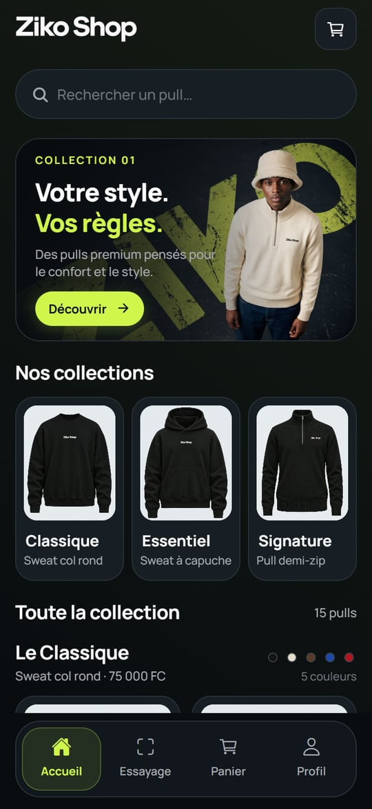
  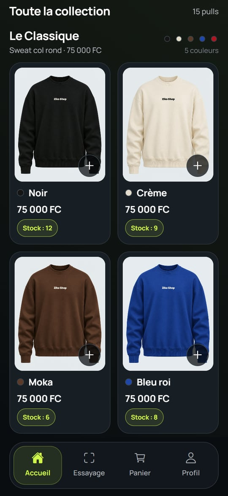
  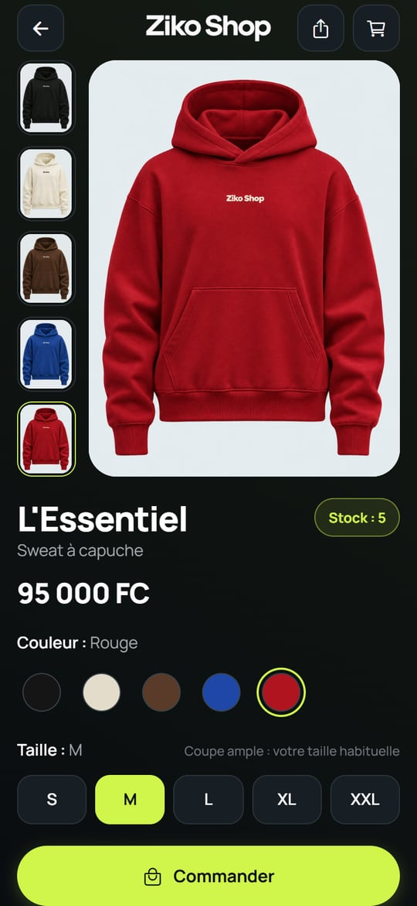
  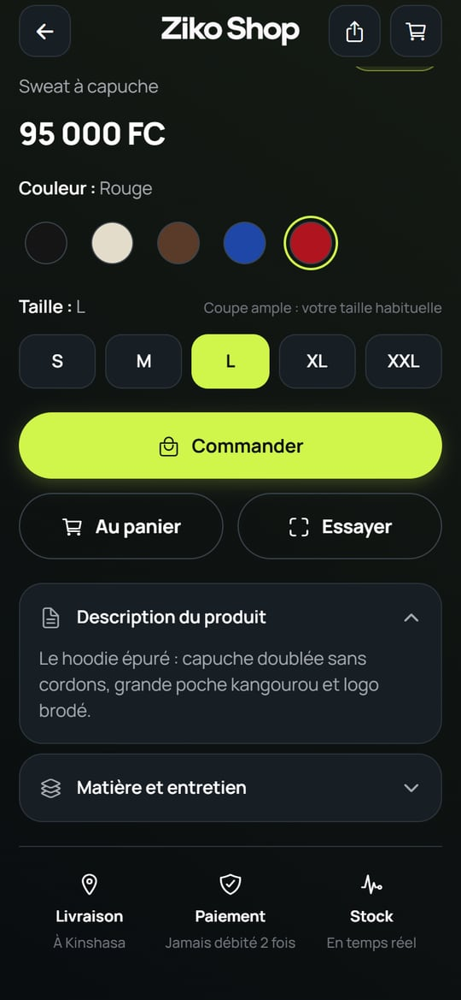
  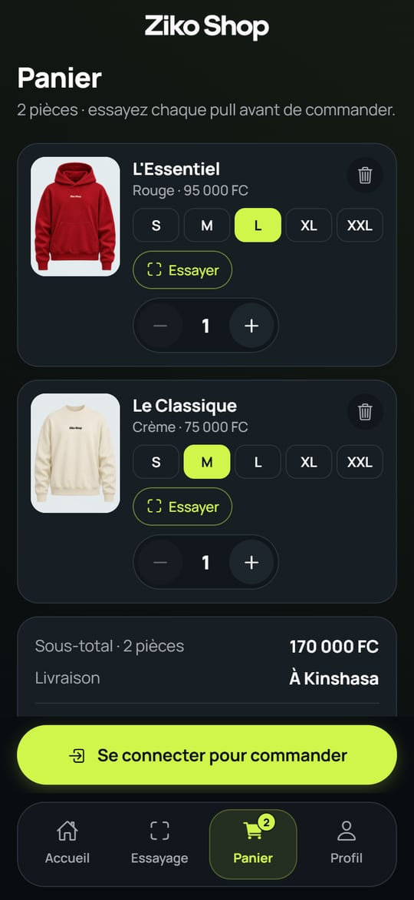
</p>
<p>
  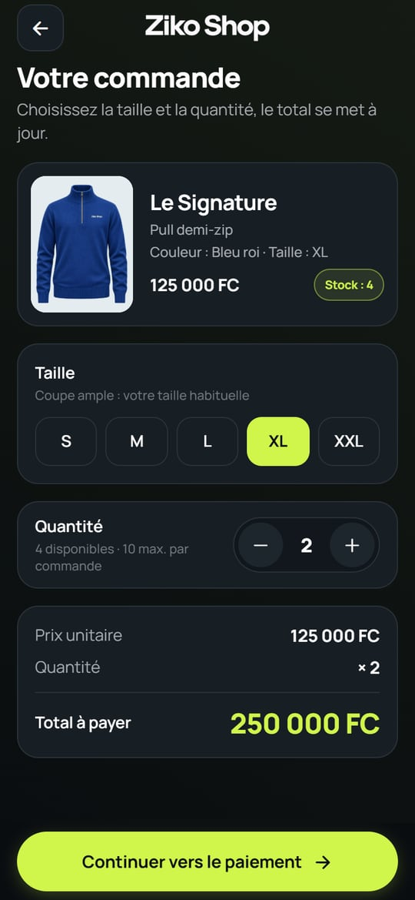
  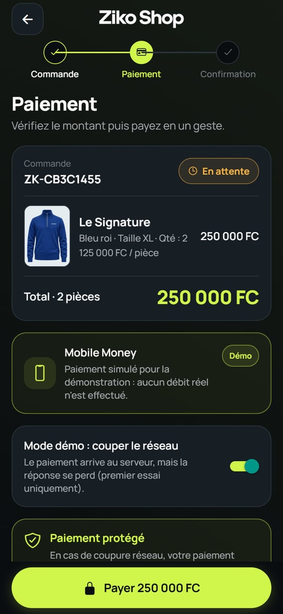
  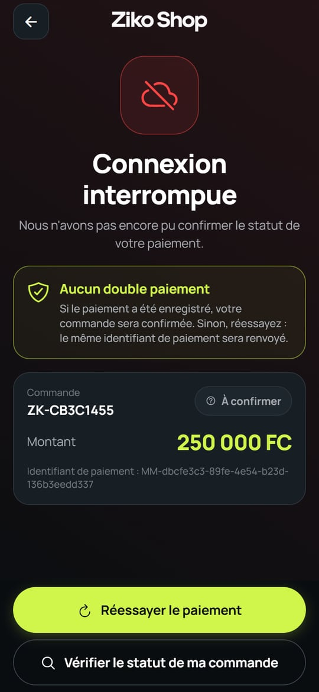
  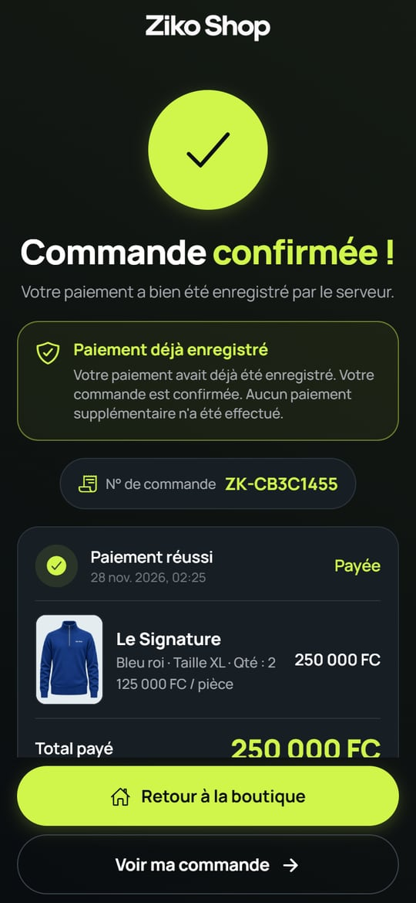
  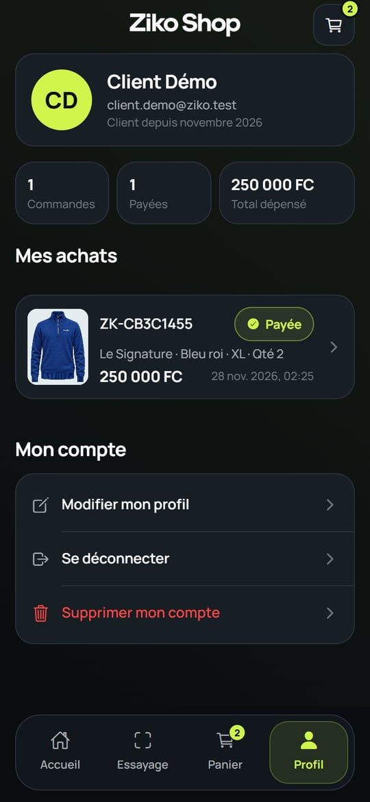
</p>
<p>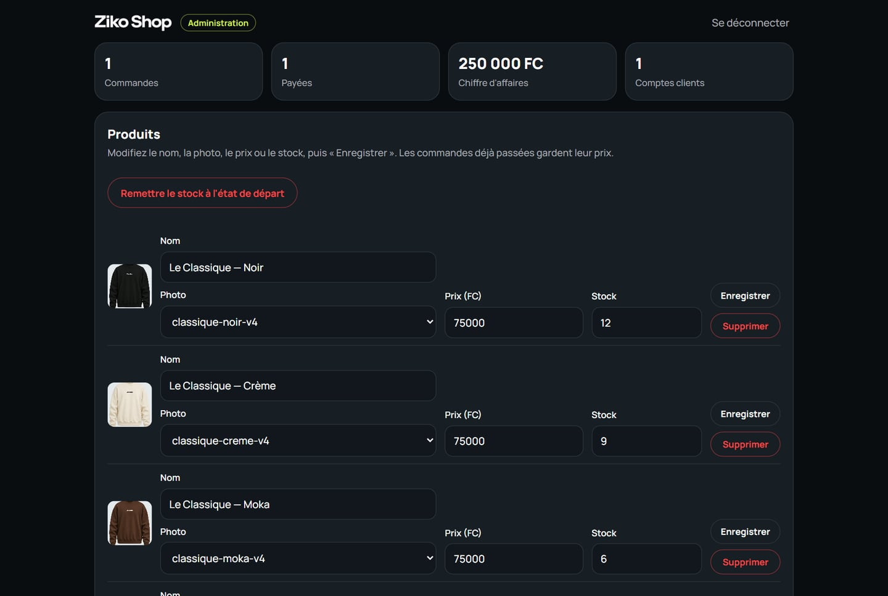</p>

---

## Sommaire

1. [Ce que fait l'application](#1-ce-que-fait-lapplication)
2. [Le point clé : jamais deux paiements](#2-le-point-clé--jamais-deux-paiements)
3. [Lancer le projet](#3-lancer-le-projet)
4. [L'API](#4-lapi)
5. [Choix techniques](#5-choix-techniques)
6. [Sécurité](#6-sécurité)
7. [Ce que j'améliorerais](#7-ce-que-jaméliorerais)
8. [Ce que j'ai fait, ce que l'IA a fait](#8-ce-que-jai-fait-ce-que-lia-a-fait)
9. [Organisation du code](#9-organisation-du-code)

---

## 1. Ce que fait l'application

**La boutique** : 3 modèles de pulls, chacun en 5 couleurs (Noir, Crème, Moka, Bleu roi, Rouge), soit 15 produits. Prix en francs congolais.

| Modèle | Type | Prix |
|---|---|---|
| Le Classique | Sweat col rond | 75 000 FC |
| L'Essentiel | Sweat à capuche | 95 000 FC |
| Le Signature | Pull demi-zip | 125 000 FC |

**Le parcours d'achat** (celui de l'énoncé, en gras) :

1. **Accueil** : les pulls sont rangés par modèle, avec leurs vraies couleurs. On peut rechercher un pull par son nom. Un message clair s'affiche pendant le chargement ou si le serveur ne répond pas.
2. **Fiche produit** : photos, choix de la couleur, **choix de la taille (S, M, L, XL, XXL)**, bouton **« Commander »**. On peut aussi « Ajouter au panier » ou « Essayer ».
3. **Commande** : taille, **quantité**, **total** recalculé, puis **« Payer »**.
4. **Paiement** : si le réseau coupe, l'app **reprend avec le même identifiant de paiement**. Le client n'est donc jamais débité deux fois.
5. **Confirmation** : la commande est payée, et le stock a baissé une seule fois.

**En plus de l'énoncé :**

- **Panier** : plusieurs pulls dans une même commande, chacun avec sa taille et sa quantité.
- **Comptes clients** : inscription, connexion, profil et historique des achats. Un compte est demandé pour commander dans l'app.
- **Essayage en direct** : la caméra filme le client et lui montre le pull porté, en vidéo, grâce au service iKawn Mirror. Une séance dure 30 secondes au plus. Si le service est indisponible, l'achat reste possible.
- **Espace administration** : modifier les prix, le stock, les noms et les photos ; ajouter, supprimer ou retirer un pull de la vente ; voir les chiffres de la boutique ; remettre le stock à l'état de départ.
- **Mode démo « couper le réseau »** sur l'écran de paiement, pour montrer la reprise sans double paiement.

Les prix s'affichent au format « 75 000 FC ». L'app fonctionne sur iPhone et Android, y compris sur petit écran.

---

## 2. Le point clé : jamais deux paiements

**Le risque.** Le client appuie sur « Payer », la requête part, puis le réseau coupe. Le client ne sait pas si le paiement est passé, et il réessaie. Sans précaution, il pourrait payer deux fois, et le stock baisser deux fois.

**La solution, côté serveur** (la vraie garantie) :

1. Le serveur **verrouille la commande** dans la base de données. Si deux paiements arrivent en même temps, le second attend son tour.
2. Il **relit le statut** de la commande :
   - déjà payée avec le même identifiant de paiement : c'est une répétition, il confirme **sans rien refaire** ;
   - déjà payée avec un autre identifiant : il refuse, et rien n'est débité.
3. Sinon, il fait **trois choses en une seule fois** : il baisse le stock, enregistre le paiement et marque la commande « payée ». C'est tout ou rien : s'il manque une seule pièce en stock, rien n'est fait.
4. **Filet de sécurité** : la base de données refuse elle-même un même identifiant de paiement deux fois, un second paiement pour une commande et un stock négatif.

**La solution, côté app** :

1. Au premier appui sur « Payer », l'app crée **un identifiant de paiement unique**.
2. Elle l'**enregistre sur le téléphone avant d'envoyer** la requête. Même si l'app se ferme, il n'est pas perdu.
3. Chaque nouvel essai renvoie **le même identifiant**. Le serveur reconnaît la répétition.
4. Sans réponse, l'app n'affiche jamais « échec ». Elle dit « Connexion interrompue », puis propose de réessayer ou de vérifier le statut auprès du serveur.

**La preuve** : des tests automatiques envoient 10 fois le même paiement en même temps (un seul passe), font payer la dernière pièce par deux clients à la fois, et simulent une coupure avant puis après l'enregistrement du paiement. Les tests serveur sont dans `server/test/payment.test.ts`, ceux de l'app dans `mobile/src/lib/payment/paymentController.test.ts`.

---

## 3. Lancer le projet

Il faut **Node.js 22 ou plus**. Docker est facultatif.

**Le serveur, avec Docker** (API et base de données en une commande) :

```bash
docker compose up --build        # API sur http://localhost:3000, avec les 15 pulls
```

**Le serveur, sans Docker** :

```bash
cd server
npm install
cp .env.example .env             # sous Windows : copy .env.example .env
npm run db:local                 # terminal 1 : une base PostgreSQL locale, sans installation
npm run dev                      # terminal 2 : l'API sur http://localhost:3000
```

**L'app** :

```bash
cd mobile
npm install
npx expo start                   # scannez le QR code avec Expo Go
```

Sans fichier `.env`, l'app utilise l'API en ligne. Pour utiliser l'API locale depuis un téléphone, mettez l'adresse IP de l'ordinateur dans `mobile/.env`, par exemple `EXPO_PUBLIC_API_URL=http://192.168.1.20:3000`.

**Les tests** (ils tournent aussi sur GitHub à chaque envoi de code) :

```bash
cd server && npm test            # 105 tests, sur une vraie base PostgreSQL jetable
cd mobile && npm test            # 31 tests : paiement, panier, tailles, catalogue
```

**Variables du serveur** :

| Variable | À quoi elle sert |
|---|---|
| `DATABASE_URL` | Adresse de la base PostgreSQL (obligatoire). |
| `ADMIN_API_KEY` | Clé de l'espace administration (16 caractères minimum en production). |
| `SEED_ON_START` | `true` : remplit la boutique avec les 15 pulls si elle est vide. |
| `IKAWN_API_KEY` | Facultative : active l'essayage en direct. |
| `DATABASE_SSL`, `CORS_ORIGINS` | Connexion chiffrée à la base, origines web autorisées. |

**En ligne** : le serveur et la base sont sur Render (fichier `render.yaml`). L'app est publiée avec EAS Update et s'ouvre dans Expo Go.

---

## 4. L'API

Réponses en JSON. En cas d'erreur, l'API renvoie toujours un code stable et un message clair en français, par exemple : `{ "error": { "code": "INSUFFICIENT_STOCK", "message": "Stock insuffisant : il reste 2 pièce(s), vous en demandez 5." } }`.

| Demandé par l'énoncé | Route |
|---|---|
| Créer un produit (nom, prix en FC, stock) | `POST /products` (clé d'administration) |
| Lister les produits | `GET /products` (recherche : `?search=`) |
| Commander un produit et une quantité | `POST /orders` avec `{ productId, quantity }` (taille facultative : `size`) |
| Payer avec un identifiant de paiement | `POST /orders/:id/pay` avec `{ paymentId }` |
| Consulter une commande | `GET /orders/:id` |

**Les règles :**

- Commande : refusée si le stock est insuffisant, sinon elle est créée « en attente ». Paiement : la commande passe à « payée » et le stock diminue.
- Taille : `S`, `M`, `L`, `XL` ou `XXL`, facultative. Une commande sans taille, au format de l'énoncé, reste valide. Une couleur n'apparaît qu'une fois par commande, dans une seule taille. Le stock est suivi par couleur.
- Panier : `{ items: [{ productId, quantity, size }, …] }`, jusqu'à 20 articles.
- Le serveur calcule lui-même les prix et le total : l'app n'envoie jamais de montant.

**Autres routes** :

- comptes : `/auth/register`, `/auth/login`, `/me`, `/me/orders` ;
- administration : `PATCH` et `DELETE /products/:id`, `/admin/summary`, `/admin/reset-stock` ;
- essayage : `/try-on/session` ;
- état du serveur : `/health`.

```bash
API=https://ziko-shop-api.onrender.com
curl $API/products
curl -X POST $API/orders -H "Content-Type: application/json" -d '{"productId":"<id>","quantity":2,"size":"L"}'
curl -X POST $API/orders/<idCommande>/pay -H "Content-Type: application/json" -d '{"paymentId":"MM-2026-000001"}'
curl -X POST $API/orders/<idCommande>/pay -H "Content-Type: application/json" -d '{"paymentId":"MM-2026-000001"}'   # renvoyé : rien n'est refait
curl $API/orders/<idCommande>
```

---

## 5. Choix techniques

- **SQL écrit à la main, sans ORM.** Le cœur du test est une transaction avec verrou : en SQL lisible, elle s'explique ligne par ligne.
- **Verrou sur la commande (`SELECT … FOR UPDATE`).** Les paiements simultanés sont rares mais critiques. Le second attend, puis répond précisément.
- **L'identifiant de paiement sert de clé anti-doublon.** C'est l'identifiant naturel d'un paiement Mobile Money.
- **Le stock baisse au paiement**, comme le demande l'énoncé. Il est revérifié sous verrou au moment de payer.
- **Le serveur fait foi.** L'app ne garde ni prix ni stock, seulement les identifiants de ses commandes et de ses paiements, et le panier.
- **Tests sur une vraie base PostgreSQL** : les verrous et les accès simultanés ne se simulent pas de façon fiable.
- **La taille est enregistrée sur la ligne de commande**, sans changer le paiement ni le décompte du stock.
- **Le panier, les comptes et l'essayage s'ajoutent au parcours de l'énoncé** sans le remplacer : `POST /orders` avec `{ productId, quantity }` fonctionne toujours, sans compte.

---

## 6. Sécurité

| Risque | Ce que j'ai fait | Ce qu'il resterait à faire |
|---|---|---|
| **Paiement non vérifié auprès d'un opérateur** (limite principale du test) | Montant calculé par le serveur, identifiant de paiement unique, 30 paiements par minute au plus. L'app indique que le Mobile Money est simulé. | Vérifier chaque paiement auprès de l'opérateur (webhook signé). |
| Création de produits par n'importe qui | Clé d'administration obligatoire, comparée de façon sûre. | Vrais comptes administrateurs. |
| Lecture des commandes des autres | Identifiants impossibles à deviner ; une commande liée à un compte n'est visible que par son propriétaire. | — |
| Vol de compte | Mots de passe hachés avec scrypt (jamais stockés en clair), 20 essais par quart d'heure, jeton de session aléatoire gardé dans le trousseau sécurisé du téléphone. | Vérification de l'e-mail, mot de passe oublié. |
| Injection SQL, montants truqués | Requêtes paramétrées, validation stricte, contrôles dans la base. | — |
| Double débit | Verrou, transaction unique, contraintes en base, testé avec 10 requêtes simultanées. | — |
| Abus, surcharge | Limites de requêtes par adresse IP, taille des requêtes limitée, requêtes lentes coupées. | Pare-feu applicatif. |
| Clés secrètes | Aucune clé dans le code : variables d'environnement. La clé iKawn ne quitte jamais le serveur. | Rotation des clés. |
| Caméra (essayage) | Autorisation du téléphone, aucune image enregistrée, séances de 30 secondes arrêtées aussi par le serveur. | Réserver l'essayage aux clients connectés. |

---

## 7. Ce que j'améliorerais

- Un vrai paiement Mobile Money (M-Pesa, Orange Money, Airtel Money), confirmé par l'opérateur.
- Un stock par taille, et un stock réservé quelques minutes pendant le paiement.
- Mot de passe oublié, vérification de l'e-mail, connexion par SMS.
- Un hébergement payant (sans mise en veille) et un CDN pour les photos.
- Des tests automatiques sur un vrai téléphone, et un suivi des erreurs en production.

---

## 8. Ce que j'ai fait, ce que l'IA a fait

L'énoncé autorise l'IA. J'ai utilisé un assistant (Claude, d'Anthropic) comme outil de développement, sous ma direction.

### Ce que j'ai fait

**La vision et le produit**

- J'ai imaginé Ziko Shop : une boutique de pulls à Kinshasa, avec trois modèles, des prix en francs congolais et une app qui semble déjà commercialisée.
- J'ai choisi la direction artistique « premium, sombre » et fourni le logo Ziko Shop et les maquettes des écrans.
- J'ai fourni les 15 photos des pulls (sur fond clair). Je les ai préférées aux visuels générés, parce qu'elles sont plus nettes.
- J'ai voulu un essayage en direct, inspiré d'une vidéo que j'avais repérée.

**Les décisions sur les fonctionnalités**, au fil du projet :

- le panier de plusieurs pulls, et deux façons d'ajouter au panier (sur la fiche, et avec le bouton « + » de l'accueil) ;
- les comptes clients obligatoires pour commander, le profil et l'historique d'achats ;
- l'espace administration (prix, stock, ajout, modification, suppression, remise du stock à l'état de départ) ;
- le mode démo « couper le réseau » et son message « Paiement protégé », visible seulement en démo ;
- l'essayage dans l'app, lancé automatiquement, limité à 30 secondes, et sans quota par client pour ce test ;
- les tailles S à XXL, le classement des pulls par modèle et les vraies couleurs des pastilles.

**Les services et les comptes** :

- j'ai créé et configuré GitHub (dépôt public), Render (serveur et base de données) et Expo (organisation et projet) ;
- j'ai invité Jonathan sur le projet Expo ;
- j'ai ouvert les comptes de l'essayage et des visuels, et payé les crédits ;
- j'ai testé l'essayage avec plusieurs fournisseurs avant de choisir iKawn Mirror.

**Les tests sur de vrais téléphones**

J'ai testé l'app sur Android et sur iPhone avec Expo Go : essayage, création de compte, commande, paiement. J'ai signalé les problèmes à corriger :

- l'essayage refusé par l'ancien fournisseur (trop de séances simultanées) ;
- le pull flou à l'essayage ;
- la lenteur du premier chargement ;
- un cadre gris qui dépassait sous la photo de la fiche ;
- des pastilles de couleur grises ;
- des pulls mal rangés à l'accueil.

**La sécurité et les règles du projet**

- Aucune clé secrète dans le dépôt public : j'ai saisi moi-même les clés et les mots de passe sur les services.
- J'ai relu et validé chaque étape avant publication.
- Je suis en mesure d'expliquer le code et de le faire évoluer.

### Ce que l'IA a fait, à partir de mes consignes

- La grande majorité du code : serveur, app, tests.
- La configuration Docker, Render, EAS et des tests automatiques sur GitHub.
- Ce README.
- La bannière de l'accueil : un mannequin fictif, généré avec l'outil d'images FLORA, qui porte le pull demi-zip crème de la collection.

---

## 9. Organisation du code

```
server/                API (Node.js, Express, TypeScript)
  src/orders/          commandes et paiement (orders.service.ts : le cœur du sujet)
  src/products/        produits
  src/auth/            comptes clients
  src/admin/           espace administration
  src/tryon/           essayage en direct (facultatif)
  src/db/migrations/   structure de la base, étape par étape
  test/                105 tests
  public/              photos des pulls, pages /essayage et /admin
mobile/                app Expo (React Native, TypeScript)
  src/app/             les écrans
  src/ui/              les composants visuels réutilisables
  src/lib/payment/     le paiement sans double débit, et ses tests
  src/lib/cart/        le panier (tailles comprises), et ses tests
docs/                  logo, maquettes, captures d'écran
docker-compose.yml     API et base en une commande
render.yaml            mise en ligne sur Render
```
