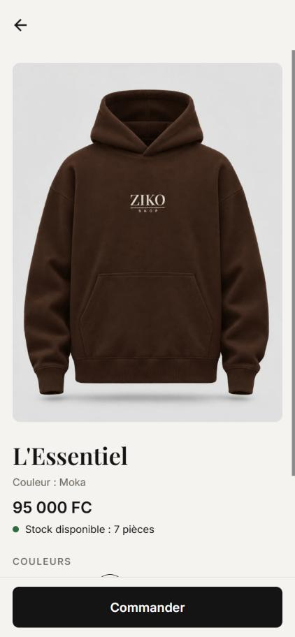
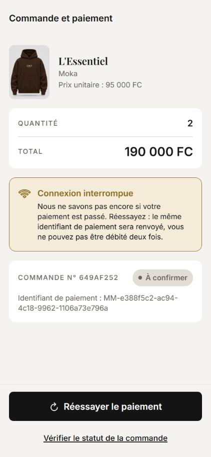
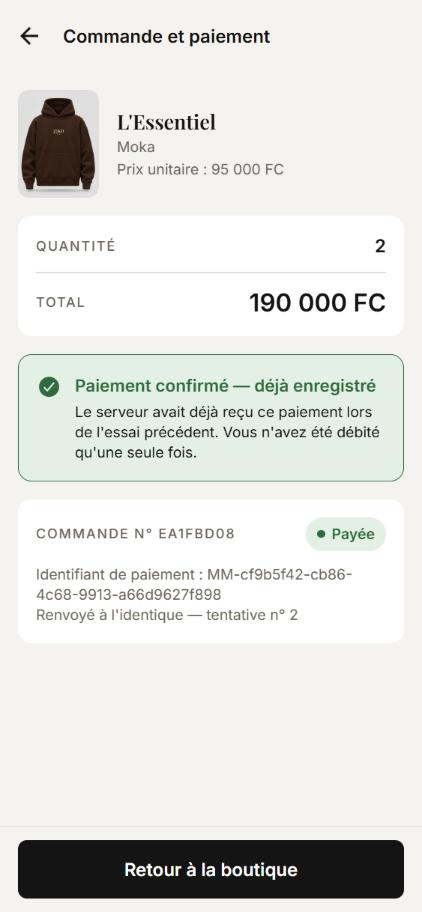

# ZIKO SHOP — boutique mobile de pulls à Kinshasa

[](https://github.com/Risthan/ziko-shop/actions/workflows/ci.yml)

Test technique « Développeur fullstack » pour Ziko : une **API** (Node.js, Express, TypeScript, PostgreSQL) qui gère des produits, des commandes et leur paiement, et une **app mobile** (React Native, Expo, TypeScript) branchée dessus.

ZIKO SHOP vend trois modèles de pulls (Le Classique, L'Essentiel, Le Signature), chacun en trois couleurs, avec des prix en francs congolais.

| | Lien |
|---|---|
| API en ligne | https://ziko-shop-api.onrender.com (`/health`, `/products`) |
| App (EAS Update) | _lien expo.dev ajouté après publication_ |
| Dépôt | https://github.com/Risthan/ziko-shop |

<p>
  
  
  
  
  
</p>

---

## Sommaire

1. [Lancer le projet](#1-lancer-le-projet)
2. [L'API](#2-lapi)
3. [Le point le plus important : jamais deux paiements](#3-le-point-le-plus-important--jamais-deux-paiements)
4. [L'app mobile](#4-lapp-mobile)
5. [Choix techniques et pourquoi](#5-choix-techniques-et-pourquoi)
6. [Sécurité : failles repérées et ce que j'ai fait](#6-sécurité--failles-repérées-et-ce-que-jai-fait)
7. [Ce que j'améliorerais avec plus de temps](#7-ce-que-jaméliorerais-avec-plus-de-temps)
8. [Ce que l'IA a écrit, ce que j'ai fait](#8-ce-que-lia-a-écrit-ce-que-jai-fait)
9. [Organisation du dépôt](#9-organisation-du-dépôt)

---

## 1. Lancer le projet

Prérequis : **Node.js 22 ou plus** (24 recommandé) et npm. Docker est facultatif.

### Le serveur, en une commande (Docker)

```bash
docker compose up --build
```

L'API répond sur http://localhost:3000, avec PostgreSQL et les 9 pulls déjà en boutique.

### Le serveur, sans Docker

```bash
cd server
npm install
cp .env.example .env      # sous Windows : copy .env.example .env
npm run db:local          # terminal 1 : lance un vrai PostgreSQL local (aucune installation)
npm run dev               # terminal 2 : lance l'API sur http://localhost:3000
```

`npm run db:local` démarre PostgreSQL grâce au paquet `embedded-postgres`. Vous pouvez aussi utiliser votre propre base : il suffit de changer `DATABASE_URL` dans `.env`. Au démarrage, les migrations s'appliquent, puis la boutique est remplie si elle est vide (`SEED_ON_START=true`).

### Les tests

```bash
cd server
npm test        # 46 tests, sur un vrai PostgreSQL jetable démarré automatiquement
npm run typecheck
```

### L'app mobile

```bash
cd mobile
npm install
cp .env.example .env      # puis mettez l'adresse de l'API (voir ci-dessous)
npx expo start            # scannez le QR code avec Expo Go
```

- Sans fichier `.env`, l'app utilise l'API en ligne.
- Pour l'API locale sur un téléphone, mettez l'IP de l'ordinateur, par exemple `EXPO_PUBLIC_API_URL=http://192.168.1.20:3000`. Le téléphone et l'ordinateur doivent être sur le même Wi-Fi.

### Variables d'environnement du serveur

| Variable | Rôle |
|---|---|
| `DATABASE_URL` | Connexion PostgreSQL (obligatoire). |
| `DATABASE_SSL` | `true` pour une base distante en TLS (le certificat est vérifié). |
| `ADMIN_API_KEY` | Clé exigée pour créer un produit. Au moins 16 caractères, obligatoire en production. |
| `SEED_ON_START` | `true` : ajoute les 9 pulls si la boutique est vide. |
| `CORS_ORIGINS` | Origines autorisées (`*` par défaut). |
| `DECART_API_KEY` / `ANYWEAR_DOMAIN` | Facultatives : activent l'essayage en direct (voir plus bas). |

### Déploiement

Le fichier `render.yaml` crée sur Render l'API (via Docker) et sa base PostgreSQL, gratuitement, dans la région Francfort. C'est la région la plus proche de Kinshasa parmi celles de Render. Il suffit de choisir **New → Blueprint → ce dépôt**.

L'hébergement gratuit met l'API en veille après 15 minutes sans visite, et le premier appel prend alors jusqu'à une minute. Deux parades :

- l'app affiche un message « le serveur se réveille » et attend jusqu'à 75 secondes ;
- un workflow GitHub (`keep-alive.yml`) garde l'API éveillée.

---

## 2. L'API

Toutes les réponses sont en JSON. Les erreurs ont toujours la même forme, avec un **code stable** (utilisé par l'app) et un **message clair en français** :

```json
{ "error": { "code": "INSUFFICIENT_STOCK", "message": "Stock insuffisant : il reste 2 pièce(s), vous en demandez 5.", "details": { "available": 2, "requested": 5 } } }
```

| # | Méthode et route | Rôle | Réponses |
|---|---|---|---|
| 1 | `POST /products` | Créer un produit `{ name, priceCdf, stock, imageUrl? }`. Exige l'en-tête `X-Admin-Key`. | 201, 400, 401 |
| 2 | `GET /products?search=` | Lister les produits (recherche facultative par nom). | 200 |
| | `GET /products/:id` | Un produit. | 200, 404 |
| 3 | `POST /orders` | Commander `{ productId, quantity }`. Refusée si le stock est insuffisant, sinon `en_attente`. En-tête `Idempotency-Key` facultatif. | 201, 200 (déjà créée), 400, 404, 409 |
| 4 | `POST /orders/:id/pay` | Payer `{ paymentId }`. La commande passe à `payee` et le stock diminue. | 200, 400, 404, 409 |
| 5 | `GET /orders/:id` | Consulter une commande et son statut. | 200, 404 |
| | `GET /health`, `GET /features` | État du serveur, fonctionnalités facultatives actives. | 200 |

Règles de données :

- **Prix** en francs congolais : un entier, de 1 à 10 000 000 FC.
- **Stock** : un entier, de 0 à 1 000 000.
- **Quantité** : de 1 à 100.
- **Identifiant de paiement** : 8 à 64 caractères (lettres, chiffres, `-` ou `_`).
- **Le serveur calcule lui-même le prix et le total.** Le client n'envoie jamais de montant.

Exemple de parcours complet :

```bash
API=https://ziko-shop-api.onrender.com
curl $API/products
curl -X POST $API/orders -H "Content-Type: application/json" -d '{"productId":"<id>","quantity":2}'
curl -X POST $API/orders/<orderId>/pay -H "Content-Type: application/json" -d '{"paymentId":"MM-2026-000001"}'
curl -X POST $API/orders/<orderId>/pay -H "Content-Type: application/json" -d '{"paymentId":"MM-2026-000001"}'   # renvoyé : rien n'est refait
curl $API/orders/<orderId>
```

---

## 3. Le point le plus important : jamais deux paiements

> Si le même paiement est envoyé deux fois, ou si la commande est déjà payée, rien ne doit être débité ni décompté une seconde fois.

### Côté serveur (`server/src/orders/orders.service.ts`, fonction `payOrder`)

Tout se passe dans **une seule transaction PostgreSQL** :

1. **`SELECT … FROM orders WHERE id = $1 FOR UPDATE`** verrouille la ligne de la commande. Si deux requêtes de paiement arrivent en même temps pour la même commande, la seconde **attend** que la première ait fini.
2. Une fois le verrou obtenu, on **relit le statut** :
   - **déjà payée avec le même identifiant** : c'est une répétition (réseau coupé, l'app a réessayé). On répond `200` avec `payment.outcome = "already_processed"`, **sans rien refaire** ;
   - **déjà payée avec un autre identifiant** : refus `409 ORDER_ALREADY_PAID`, aucun débit.
3. Un identifiant de paiement déjà utilisé pour **une autre commande** est refusé (`409 PAYMENT_ID_ALREADY_USED`).
4. Le stock est relu sous verrou. S'il ne suffit plus, on renvoie `409 INSUFFICIENT_STOCK` et rien n'est débité.
5. Sinon, **dans la même transaction**, trois opérations : le stock diminue, le paiement est enregistré, la commande passe à `payee`. C'est **tout ou rien**.

**Filet de sécurité dans la base**, même en cas de bug applicatif :

- la table `payments` a pour **clé primaire l'identifiant de paiement**, qui ne peut donc pas être enregistré deux fois ;
- elle impose aussi **une contrainte `UNIQUE` sur `order_id`** : une commande ne peut pas avoir deux paiements ;
- `CHECK (stock >= 0)` empêche le stock de devenir négatif.

```mermaid
sequenceDiagram
  participant App
  participant API
  participant DB as PostgreSQL
  App->>API: POST /orders/42/pay { paymentId: MM-abc }
  API->>DB: BEGIN ; SELECT … FOR UPDATE (verrou)
  API->>DB: stock - 2, INSERT payment, statut = payee ; COMMIT
  API--xApp: réponse perdue (réseau coupé)
  Note over App: « Connexion interrompue »<br/>statut « À confirmer »
  App->>API: POST /orders/42/pay { paymentId: MM-abc } (le MÊME)
  API->>DB: SELECT … FOR UPDATE : déjà payée par MM-abc
  API-->>App: 200 outcome = already_processed (rien n'est refait)
  Note over App: « Paiement confirmé — déjà enregistré.<br/>Débité une seule fois. »
```

### Côté app (`mobile/src/lib/usePaymentFlow.ts`)

- L'app crée **un identifiant de paiement par commande**, au premier appui sur « Payer ». Elle le **réutilise à l'identique** à chaque nouvelle tentative. C'est ce qui permet au serveur de reconnaître une répétition.
- La création de commande porte aussi une **clé d'idempotence**. Si le réseau coupe à ce moment-là, réessayer ne crée pas une seconde commande.
- Les échecs sont classés en trois familles, car ils n'appellent pas la même réponse :
  - **réseau coupé ou délai dépassé** : on ne sait pas si le serveur a traité le paiement. L'app affiche « Connexion interrompue », le statut « À confirmer », et propose « Réessayer » avec le même identifiant, ou « Vérifier le statut » ;
  - **refus métier** (stock épuisé, commande introuvable) : message clair et « aucun débit n'a été effectué » ;
  - **succès** : l'app distingue « payé à l'instant » de « ce paiement avait déjà été enregistré ».
- **Mode démo** (interrupteur sur l'écran de paiement) : la requête part vraiment au serveur, puis l'app fait comme si la réponse s'était perdue. C'est exactement le cas du réseau qui coupe pendant le paiement, et il est reproductible pendant la vidéo. Couper le Wi-Fi ou passer en mode avion marche aussi.

### Ce qui le prouve (`server/test/payment.test.ts`)

Les tests tournent sur un vrai PostgreSQL. Chacun vérifie la réponse HTTP **et** l'état de la base : stock et nombre de paiements.

- le même paiement renvoyé : 200 `already_processed`, stock inchangé ;
- **10 envois simultanés** du même paiement : 1 seul `processed`, 1 seul paiement en base ;
- 5 identifiants différents envoyés en même temps : un seul passe, les autres reçoivent 409 ;
- deux clients pour la dernière pièce : un seul paie, et le stock reste à 0 ;
- un identifiant réutilisé sur une autre commande : 409.

---

## 4. L'app mobile

Expo SDK 58, Expo Router et TypeScript strict. L'app fonctionne sur iPhone et Android, et reste lisible sur petit écran : textes plafonnés à ×1,35 avec la taille système, grille en 2 colonnes et boutons de 44 px minimum.

1. **Liste des produits** (`src/app/index.tsx`) : chargée depuis l'API. Elle affiche un indicateur pendant le chargement, puis « le serveur se réveille… » si l'attente dure. Un message clair et un bouton « Réessayer » apparaissent si le serveur ne répond pas. On peut tirer pour rafraîchir. La recherche par nom ignore les accents : « creme » trouve « Crème ».
2. **Fiche produit** (`src/app/product/[id].tsx`) : nom, prix au format « 75 000 FC », stock, pastilles des autres couleurs du modèle et bouton « Commander ». Le bouton est désactivé en cas de rupture.
3. **Commande et paiement** (`src/app/order/[productId].tsx`) : quantité modifiable (dans la limite du stock), total mis à jour, bouton « Payer ». L'app affiche ensuite le statut final : `Payée`, `En attente` ou `À confirmer`, avec le numéro de commande et l'identifiant de paiement.

Le design reprend la direction visuelle ZIKO SHOP (dossier `docs/design`) : fond crème `#F5F3EF`, noir profond, accent moka, titres en Playfair Display et texte en Inter.

### Bonus : l'essayage en direct

Sur la fiche produit, un bouton « Essayer en direct » ouvre la page `/essayage` de l'API. Le client s'y voit porter le pull, en vidéo, avec la caméra de son téléphone. Cette fonctionnalité est **facultative et isolée** (`server/src/tryon`) : sans configuration, le bouton n'apparaît pas, et rien du reste n'en dépend.

- **Mode Decart** (`DECART_API_KEY`) : modèle temps réel `lucy-vton` via WebRTC. La clé reste sur le serveur. Le navigateur ne reçoit qu'un jeton de 60 secondes, limité à ce modèle, à l'origine de la page et à des séances de 45 secondes.
- **Mode AnyWear** (`ANYWEAR_DOMAIN`) : charge le widget officiel AnyWear de Decart, une fois le domaine activé sur anywear.decart.ai/install.

---

## 5. Choix techniques et pourquoi

- **Express 5 et SQL direct (`pg`), sans ORM.** Le cœur du sujet est une transaction avec verrou. Écrite en SQL lisible, elle s'explique ligne par ligne, sans magie cachée. Express 5 gère nativement les erreurs des fonctions `async`.
- **Le verrou pessimiste (`SELECT … FOR UPDATE`) plutôt qu'un verrou optimiste.** Les paiements concurrents sur une même commande sont rares mais critiques. Le verrou les met en file d'attente, et la seconde requête lit l'état final pour répondre précisément. Les contraintes `UNIQUE` servent de seconde ligne de défense.
- **L'identifiant de paiement sert de clé d'idempotence.** C'est l'identifiant naturel d'un paiement Mobile Money : pas besoin d'inventer une autre clé.
- **Le stock diminue au paiement, pas à la commande**, comme le demande le sujet. Il est donc revérifié sous verrou au moment de payer.
- **zod** valide toutes les entrées, avec des messages en français, et la configuration est validée au démarrage. Des bornes claires évitent les montants absurdes.
- **Les tests tournent contre un vrai PostgreSQL** (`embedded-postgres`). Les verrous et la concurrence ne se simulent pas de façon fiable : il faut une vraie base.
- **L'app n'utilise pas de bibliothèque d'état.** Un hook dédié (`usePaymentFlow`) contient toute la logique de paiement, séparée de l'affichage. C'est simple à lire et à faire évoluer.
- **La recherche se fait côté app** (9 produits, instantanée et tolérante aux accents). L'API propose aussi `?search=` pour un catalogue plus grand.
- **Render gratuit et Docker.** Le même conteneur tourne en local (`docker compose`), en CI et en production.

---

## 6. Sécurité : failles repérées et ce que j'ai fait

| Faille possible | Ce que j'ai fait | Ce qui reste |
|---|---|---|
| **Paiement non vérifié auprès d'un opérateur.** N'importe qui connaissant l'identifiant d'une commande pourrait la « payer » avec un identifiant inventé. | Identifiants de commande aléatoires (UUID v4) et impossibles à deviner. Montant calculé et figé côté serveur. Identifiant de paiement unique. Limite de 30 paiements par minute et par IP. | En production : vérifier chaque paiement auprès de l'opérateur Mobile Money (API ou webhook signé HMAC), avec contrôle du montant. C'est la limite principale de ce test. |
| **Création de produits par n'importe qui.** | En-tête `X-Admin-Key` comparé à temps constant. Clé d'au moins 16 caractères, obligatoire en production. Sur Render, elle est générée automatiquement et transmise séparément aux évaluateurs. | Vrais comptes administrateurs avec rôles. |
| **Lecture des commandes d'autrui (IDOR).** | UUID impossibles à deviner, et aucune route ne liste les commandes. | Comptes clients ou jeton secret propre à chaque commande. |
| **Injection SQL.** | Requêtes paramétrées partout. Recherche `LIKE` échappée : `%` et `_` sont traités comme du texte. | — |
| **Montants ou quantités manipulés.** | Validation stricte (entiers, bornes). Prix et total calculés par le serveur. Contraintes `CHECK` en base, dont `total = prix × quantité` et `stock >= 0`. | — |
| **Double débit en concurrence.** | Verrou, transaction unique et contraintes `UNIQUE`, testés avec 10 requêtes simultanées. | — |
| **Abus ou déni de service.** | Limite globale de 300 requêtes par 15 minutes et par IP. Corps JSON de 10 ko maximum. Requêtes SQL coupées après 10 secondes. | Un pare-feu applicatif ou un CDN en production. |
| **Fuite d'informations.** | Erreurs 500 génériques, sans pile d'appels. `X-Powered-By` désactivé. En-têtes de sécurité via `helmet`. Certificat TLS de la base vérifié. | Journalisation centralisée et alertes. |
| **Secrets exposés.** | Variables d'environnement, `.env` ignoré par Git. La clé Decart ne part jamais vers le navigateur, qui reçoit un jeton court et restreint. | Rotation des clés. |
| **Script tiers (widget AnyWear).** | Autorisé uniquement sur `/essayage`, avec une politique de sécurité (CSP) dédiée. L'accès à la caméra est limité à cette page. | Figer une version du widget plutôt que `latest`. |
| **CORS ouvert (`*`).** | Acceptable ici : l'API n'utilise ni cookie ni session, et l'app mobile n'est pas soumise à CORS. Configurable via `CORS_ORIGINS`. | Restreindre si un site web est ajouté. |

Le conteneur Docker tourne **sans les droits root**.

---

## 7. Ce que j'améliorerais avec plus de temps

- **Un vrai paiement Mobile Money** (M-Pesa, Orange Money, Airtel Money, via un agrégateur), confirmé par un webhook signé, avec un statut intermédiaire « en cours ».
- **Réserver le stock** pendant 15 minutes à la création de la commande, pour éviter qu'un client découvre une rupture au moment de payer.
- **Garder le paiement en cours sur le téléphone** (AsyncStorage) pour le reprendre si l'app est fermée en plein paiement.
- Comptes clients, historique des commandes et panier de plusieurs produits.
- Tests de bout en bout de l'app (Maestro), documentation OpenAPI et suivi des erreurs (Sentry).
- Un hébergement payant (pas de mise en veille) et un CDN pour les images.

---

## 8. Ce que l'IA a écrit, ce que j'ai fait

Comme le sujet l'autorise, j'ai utilisé un assistant IA (Claude, d'Anthropic) comme outil de développement.

- **Écrit par l'IA, à partir de mes consignes :** la grande majorité du code (serveur, app, tests), la configuration Docker, Render et CI, ce README, ainsi que les visuels (logo, photos des 9 pulls, maquettes), générés avec l'outil d'images FLORA.
- **Fait par moi :**
  - le choix du produit et de la direction : boutique de 3 pulls, design premium, prix en francs congolais, essayage en direct inspiré d'une vidéo que j'ai repérée ;
  - la validation des visuels et du design ;
  - la création et la configuration des comptes et services : GitHub, Render, Expo ;
  - le déploiement et les essais sur téléphone ;
  - la relecture du code, que je suis en mesure d'expliquer et de faire évoluer.

---

## 9. Organisation du dépôt

```
server/                 API Node.js + Express + TypeScript
  src/
    app.ts              assemblage de l'app Express (sécurité, routes, erreurs)
    config.ts           variables d'environnement validées
    db/                 connexion, transactions, migrations SQL, données de départ
    products/           routes, validation et logique des produits
    orders/             commandes et paiement (orders.service.ts : le cœur)
    http/               erreurs, middlewares, validation
    tryon/              essayage en direct (facultatif)
  test/                 46 tests (Vitest + Supertest + vrai PostgreSQL)
  web/essayage/         script de la page d'essayage (compilé par esbuild)
  public/               images des pulls, page /essayage
mobile/                 app Expo (React Native + TypeScript)
  src/app/              les 3 écrans (Expo Router)
  src/api/              client HTTP typé et gestion des erreurs réseau
  src/lib/              logique de paiement, formatage « 35 000 FC »
  src/components/       composants d'interface
docs/                   direction visuelle et captures d'écran
docker-compose.yml      API + PostgreSQL en une commande
render.yaml             déploiement Render
```
